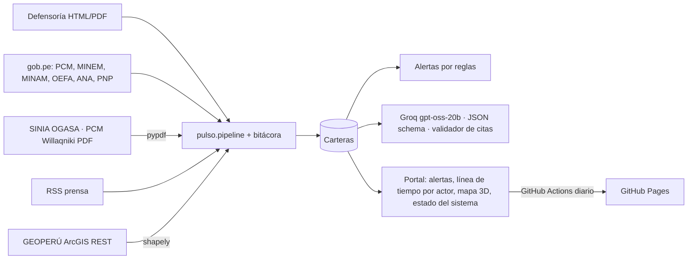

# PulsoTerritorial

**Demo pública:** https://alexnoblejas.github.io/pulso-territorial/ · accesos directos `?company=mineria` y `?company=hidrocarburos` · se actualiza sola cada día ([ver ejecuciones](https://github.com/AlexNoblejas/pulso-territorial/actions/workflows/pages.yml))
**Acceso de demostración:** elige la organización (Antamina, Las Bambas o Petroperú), escribe tu nombre como usuario y usa la contraseña `2026`. Es un acceso simulado en el navegador: sirve para mostrar el flujo de un analista, no protege datos ni representa a las empresas.
**Autor:** Alexander Noblejas · Python Intermedio, Diplomatura en Ciencia de Datos (Q-Lab PUCP) · [Issue #204](https://github.com/d2cml-ai/Data-Science-Python/issues/204)

## 1. One-liner

Hacemos alerta temprana de conflictos sociales para empresas mineras y de hidrocarburos. Para eso cruzamos cada día lo que dicen la Defensoría, el Ejecutivo, los fiscalizadores, la policía y la prensa sobre el territorio donde operan, y cada afirmación lleva a su fuente.

## 2. Founder

**Alexander Noblejas.** Trabaja con información de conflictos sociales del Perú: el archivo de reportes mensuales de la Defensoría del Pueblo 2004-2025 y la base histórica que usa este producto vienen de su investigación de tesis. En el curso construyó el scraper de prensa (tarea 1), un pipeline de OCR y transcripción (tarea 2), un MCP sobre GEOPERÚ y uno sobre el BCRP (tarea 4), y el análisis de incendios en Ucayali.

## 3. Problema

Un equipo de relaciones comunitarias tiene que saber a tiempo qué pasa con sus conflictos. Necesita ver en qué fase están, qué plazos vencen, si hay un paro anunciado y qué dicen el Estado y la comunidad. Hoy eso está repartido:

- **La Defensoría** publica un reporte mensual, en HTML y en PDF.
- **El Ejecutivo** comunica por su lado: la PCM y el MINAM en revistas e informes, y el MINEM en notas de prensa.
- **Los fiscalizadores** (OEFA, ANA), **la policía** y **la prensa** también publican por separado, con fechas y nombres que no siempre coinciden.

Cada fuente mira desde su función, y por eso hay que contrastarlas. Cuando la gestión social no ve una señal o comunica un dato equivocado, la operación puede detenerse. Ejemplo real dentro de la demo: la Defensoría fecha el derrame de Sinchi Roca el 19 de febrero de 2025 y el MINAM el 19 de marzo.

**Evidencia de usuarios:** no se hicieron las tres conversaciones que pide el curso. No se incluyen testimonios inventados; la guía de entrevista está en [`docs/research/`](docs/research/).

## 4. Solución e insight

Tres carteras demo: **Antamina** (minería, Áncash y Huánuco), **Las Bambas** (minería, Apurímac) y **Petroperú** (hidrocarburos, Loreto). Un analista de gestión social ingresa con su nombre y ve solo la cartera de su organización. Cada cartera tiene:

- **Alertas tempranas** por reglas explícitas. Cubren medidas de fuerza, violencia, incidentes de seguridad, estados de emergencia, picos de cobertura, plazos próximos o vencidos sin registro posterior, falta de información oficial reciente y discrepancias entre fuentes. Cada alerta muestra la regla que la activó y su evidencia ([`pulso/alerts.py`](pulso/alerts.py)).
- **Con quién gestionar:** actores primarios, secundarios y terciarios de cada conflicto, tal como los nombra la Defensoría.
- **Historial vinculado:** todos los conflictos de la empresa en los reportes de la Defensoría 2012-2025, con su último estado. En Antamina son 20, y los que siguen activos sin un cierre reportado generan una alerta.
- **Conflictos del país:** los 77 conflictos activos con ficha del reporte vigente, en un mapa por tipo, con filtros por región, tipo, "mis departamentos", "nombran a mi empresa" y diálogo. Incluye la serie de quince años (2012-2025) del país y de los departamentos de la operación.
- **Lore, la asistente:** una llamita en la esquina que responde sobre alertas, actores, conflictos, regiones, años, términos ("¿qué es un actor terciario?") y cómo usar cada pantalla. Responde solo con los datos de la plataforma, con su fuente, y si no sabe lo dice. Con una clave de IA local, las preguntas abiertas van a Groq con validación de citas.
- **Línea de tiempo por actor** en cada conflicto: Defensoría, Ejecutivo, Fiscalización y agua, Policía, Empresa y Prensa. Al hacer clic en un punto se ve qué reportó cada actor ese mes, con el encuadre de la fuente.
- **Contexto territorial desde GEOPERÚ:** concesiones de la empresa, comunidades tituladas, lotes, oleoducto, áreas protegidas, unidades hidrográficas y pasivos ambientales, en el mapa 3D y dentro de cada expediente.
- **Citas verificables:** cada pasaje de un PDF abre el documento oficial en su página.
- **Lectura con IA:** Groq extrae hechos, demandas y compromisos. Cada afirmación debe traer una cita literal o se descarta.
- **Reporte mensual narrativo:** resumen ejecutivo redactado desde los datos, agenda sugerida para el analista, una ficha por conflicto (situación, qué pasó en el mes, con quién gestionar, compromisos, qué dicen las demás fuentes, alertas y territorio) y cinco figuras. Cada figura dice qué muestra, su fuente, su fecha de corte y cómo leerla.
- **Actuación del Estado en el territorio** y **Pulso de medios**.

**Insight:** el valor está en que cada señal sea comprobable y llegue a tiempo, no en resumir. Por eso el producto declara sus límites en lugar de esconderlos:

- **Homónimos:** existen una comunidad Sinchi Roca en Huánuco y un parque Sinchi Roca en Comas. Un nombre ambiguo solo se vincula al caso si en el mismo texto aparece un término de anclaje, como Manseriche, Datem, oleoducto o derrame. Esto lo cubre una prueba.
- **Ubicación:** un punto distrital nunca se presenta como la comunidad. Si la capa oficial tiene el polígono comunal, las distancias se miden desde él.
- **Lo que no se afirma:** la cercanía no prueba afectación, una nota de prensa es una señal y no prueba un hecho, y la fase es la que reporta la Defensoría, no una predicción.

## 5. Why now

- **IA que se puede verificar:** un modelo abierto en Groq devuelve JSON con esquema estricto por menos de una décima de centavo de dólar por caso.
- **El Estado ya publica en formatos procesables:** la Defensoría tiene fichas HTML por caso (RCS 271), MINAM/OGASA publica informes mensuales en SINIA, gob.pe centraliza las notas de prensa de todas las entidades y GEOPERÚ expone sus capas por ArcGIS REST.
- **Automatizar no cuesta:** GitHub Actions corre el ciclo cada día y GitHub Pages lo publica, sin servidor propio.

## 6. Demo y arquitectura

**Pública:** https://alexnoblejas.github.io/pulso-territorial/. La vista **Estado del sistema** muestra la última ejecución automática paso por paso, cada conector con su última lectura y el historial de ejecuciones.

**Local (con IA en vivo):**

```powershell
.\instalar.ps1
copy .env.example .env   # poner GROQ_API_KEY
.\iniciar.ps1            # http://127.0.0.1:8765  (-Automatizar: ciclo cada 24 h)
python -m pulso.pipeline # ciclo completo a mano, con bitácora
```

### Fuentes que se leen solas cada día ([`pulso/pipeline.py`](pulso/pipeline.py))

| Fuente | Qué trae | Cómo | Módulo |
|---|---|---|---|
| Defensoría del Pueblo | Reporte mensual: fichas por caso (HTML) e historial de pasajes por caso (PDF) | Catálogo de la Defensoría, `requests`, BeautifulSoup y pypdf | `service.py`, `sources.py` |
| gob.pe | Notas y comunicados de PCM, MINEM, MINAM, OEFA, ANA, PNP, Mininter y Petroperú | Buscador de gob.pe ordenado por fecha; sin paginar, porque su robots.txt lo prohíbe | `sources.py` |
| SINIA · MINAM/OGASA | Informes mensuales de conflictos socioambientales | Listado de SINIA, descarga del PDF y pasajes por caso con página | `sources.py` |
| PCM · Willaqniki | Revista de la Secretaría de Gestión Social y Diálogo | Colección de gob.pe, PDF y pasajes por caso con página | `sources.py` |
| Prensa | El Comercio, La República, Andina y Google News, que suma RPP, Gestión, Infobae y medios regionales | RSS, con la estrategia de la tarea 1 | `news.py` |
| GEOPERÚ (MINAM) | Concesiones, comunidades campesinas y nativas, lotes, oleoducto, ANP, unidades hidrográficas y pasivos | ArcGIS REST `/query` recortado al área de la cartera, con el protocolo del MCP de la tarea 4 | `geoperu.py` |
| Corpus curado | 6 PDF con 8 citas revisadas a mano | Verificación con SHA-256 y texto literal | `corpus.py` |
| Enlaces | Todos los enlaces que muestra la plataforma (278 en la última revisión local) | HEAD/GET en paralelo; distingue enlace roto de servidor que bloquea al verificador | `links.py` |
| Historial (una vez) | Conflictos de cada empresa y del país, 2012-2025 (33,845 filas, 1,073 conflictos) | `scripts/importar_historico.py` e `importar_historico_nacional.py` sobre la base de tesis | `demo_data/historical_*.json` |
| Ubicación nacional | Distrito, provincia o departamento de cada conflicto del país | Límite distrital de GEOPERÚ (`scripts/geocodificar_nacional.py`) | `national.py` |

- **Cortesía con las fuentes:** User-Agent académico, pausas y un reintento.
- **Si una fuente falla:** se conserva su última copia y la falla queda en la bitácora.
- **Historial sin commits:** antes de cada ejecución, el workflow recupera del sitio publicado el estado acumulado (bitácora, prensa y fuentes).



**Modelo de IA:** `openai/gpt-oss-20b` en Groq. Se eligió porque es abierto, admite salida con esquema JSON estricto y es barato. Se probó en real el 10 de noviembre de 2026 sobre 3 casos: aceptó 23 afirmaciones con cita y descartó 3, con entre 1,390 y 1,920 tokens por caso. El resultado está en [`demo_data/ai_readings.json`](demo_data/ai_readings.json). La versión pública no tiene clave, así que muestra esa lectura con su fecha y modelo.

**Corpus curado** ([`config/corpus.json`](config/corpus.json), PDF en [`corpus/`](corpus/)): MINAM/OGASA 03-2025 y 09-2025, con hash idéntico al de SINIA; PCM Willaqniki N.º 5-2024; MINEM/OGGS IV trimestre 2016; OEFA Reporte 00015-2022 y Resolución TFA 497-2022. Los tres últimos son copias del archivo del autor, porque su URL oficial no está confirmada.


## 7. Modelo de negocio y costos

- **Quién paga:** el área de relaciones comunitarias o de asuntos corporativos de una empresa extractiva, o la consultora que le hace el seguimiento.
- **Precio:** piloto de **S/ 299 al mes por cartera**, hasta 25 casos, con alertas diarias y reporte mensual. Es una hipótesis: no se validó con clientes.
- **Costo de IA:** según la prueba real, menos de 2,000 tokens por lectura. A la tarifa de terceros de US$ 0.075 por millón de tokens de entrada y US$ 0.30 por millón de salida, eso es menos de **US$ 0.001 por lectura** y menos de US$ 1 al mes por cartera.
- **Costo de servidor:** US$ 0 (GitHub Pages y Actions; un ciclo completo dura unos 9 minutos). Una versión con cuentas de cliente necesitaría un servidor pagado.
- **Costo de revisión humana:** no se midió y probablemente es el mayor.

## 8. Herramientas del curso

| Sesión | Uso dentro del producto | Archivo |
|---|---|---|
| **03 Scraping y APIs** | Defensoría, buscador de gob.pe, SINIA, PCM y RSS de prensa (estrategia de la tarea 1) | `service.py`, `sources.py`, `news.py` |
| **08 LLMs con salidas estructuradas** | Groq con esquema JSON estricto y validador de citas literales | `service.py`, `web.py` |
| **10 Document AI** | pypdf: pasajes por caso con página en los PDF de Defensoría, OGASA y Willaqniki, y verificación del corpus; adaptador PaddleOCR opcional | `sources.py`, `corpus.py`, `ocr_optional.py` |
| 04 MCP / 06 GeoPandas | Capas de GEOPERÚ por ArcGIS REST (el mismo servidor del MCP de la tarea 4) y contexto territorial con shapely | `geoperu.py` |
| 05 Dashboards | Portal con alertas, conflictos del país, línea de tiempo por actor, pulso de medios, reporte mensual y la asistente Lore | `web/`, `reports.py`, `national.py` |
| 12 Despliegue | Ciclo diario en GitHub Actions, sitio en GitHub Pages y bitácora visible | `pipeline.py`, `export.py`, `.github/workflows/pages.yml` |

**Por qué estas:** las fuentes oficiales vienen en HTML, PDF y servicios geográficos, lo que pide scraping, Document AI y GEOPERÚ. Para que la IA sirva a una empresa, su salida tiene que ser estructurada y verificable.

## 9. Qué hizo el agente

- **Codex (OpenAI):** construyó la primera versión. Hizo el servidor, el frontend, el modelo de datos de carteras, las capas geográficas locales y los reportes.
- **Claude Code** hizo lo siguiente:
  - Los conectores de gob.pe, SINIA, Willaqniki y los PDF de la Defensoría (`sources.py`) y el de GEOPERÚ (`geoperu.py`).
  - El ciclo con bitácora (`pipeline.py`), las alertas (`alerts.py`), la línea de tiempo por actor y la vista Estado del sistema.
  - El corpus verificado (`corpus.py`), la corrección y la prueba real de Groq, el monitor de prensa (`news.py`) y el despliegue diario.
  - Detectó y corrigió errores de vinculación: homónimos de Sinchi Roca, un punto distrital leído como comunidad, el TUPA de la PCM mezclado con Willaqniki y frases de casos vecinos en el contexto que se enviaba a la IA.

Las decisiones de qué fuentes usar y cómo presentarlas son del autor. **Verificación:** 33 pruebas `pytest`, que incluyen una cita alterada, un PDF reemplazado y homónimos.

Guion de la presentación: [`docs/PRESENTACION.md`](docs/PRESENTACION.md).

**Pendiente y límites:**

- **Entrevistas con usuarios:** no se hicieron.
- **PNP:** no tiene un parte público en formato abierto. Sus notas en gob.pe y la prensa son la única vía, y hoy no hay notas de la PNP que nombren estos casos.
- **ANA:** su servidor ArcGIS no respondía. Entra por sus notas en gob.pe y por las unidades hidrográficas de GEOPERÚ.
- **Servicio para clientes:** faltan autenticación de clientes y envío del reporte por correo.
- **Reportes de la Defensoría:** cada ejecución descarga los dos más recientes. El historial largo (2004-2025) viene de la base de tesis importada en `demo_data/historical.json`, no de descargas diarias.
