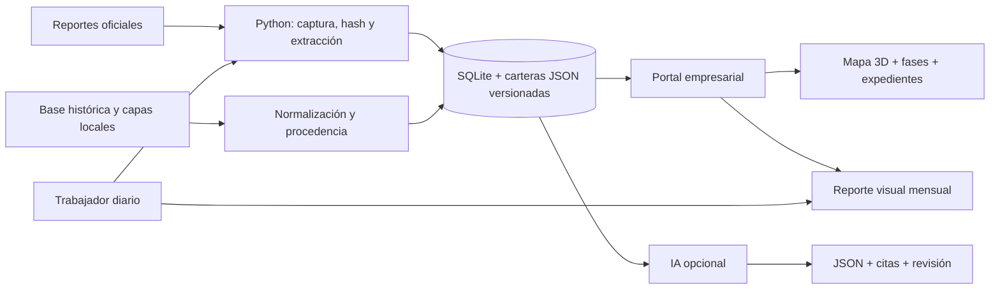

# PulsoTerritorial

## 1. One-liner

Hacemos monitoreo documental de conflictos y contexto territorial para equipos de gestión social empresarial mediante fuentes públicas, mapas y reportes visuales trazables.

## 2. Founder

**Alexander Noblejas.** Proyecto individual de Python Intermedio, apoyado en su trabajo previo con información de conflictos sociales. No se presenta experiencia, entrevistas ni ventas que no se hayan acreditado.

## 3. Problema

Reconstruir el estado de un conflicto, su agenda y lo que afirma cada institución requiere cruzar reportes y cartografía dispersos. El producto organiza esa evidencia por cartera y expediente. El ahorro de tiempo y la disposición a pagar están por medir. El autor confirmó que presentará sin las tres conversaciones de usuarios: no se incluyen testimonios ficticios. Guía en docs/research.

## 4. Solución e insight

Dos recorridos de demostración: **Las Bambas** y **Petroperú**. El resumen conecta mapa, fases, historia y lecturas del período. Cada expediente muestra demandas, acontecimientos, compromisos reportados y fuentes. La cartera hidrocarburos evidencia una discrepancia de fecha del derrame y la diferencia entre entregar una cisterna y asegurar la continuidad del agua.

Una ubicación compartida no prueba afectación; un estado es una observación del período. La fase oficial no se infiere de una curva ni del diálogo. Las carteras son muestras documentadas, no un censo empresarial o nacional.

## 5. Why now

Reportes públicos estructurados, cartografía accesible y herramientas Python permiten construir una capa de seguimiento reutilizable. La diferenciación propuesta es la unión de historia, territorio y evidencia por cliente; la ventaja comercial sigue por validar.

## 6. Demo y arquitectura

```powershell
.\instalar.ps1
.\iniciar.ps1
```

Abrir http://127.0.0.1:8765 . Accesos directos `/?company=mineria` y `/?company=hidrocarburos`. Elegir perfil no autentica ni representa una cuenta real. Si PowerShell no permite scripts, ejecutar `.\.venv\Scripts\python.exe -m pulso.web` desde la carpeta.

Para actualización diaria mientras el proceso esté activo: `.\iniciar.ps1 -Automatizar`. El trabajador captura documentos, reconstruye fichas HTML y genera reportes. Cada ciclo limita descargas; no pretende cubrir todo el historial en un día. La laptop debe estar encendida; no se instaló tarea de Windows. Noticias y vínculos adicionales conservan revisión editorial, no un feed automático completo. El correo aún no se envía.



El servidor `pulso/web.py` sirve la API y el frontend de `web/`; `pulso/portfolio.py` construye carteras, `reports.py` produce HTML con SVG y `service.py` conserva documentos y contratos de IA. La muestra estructurada de demo se copia al directorio de datos si falta. Los originales de la copia local están en data/raw; las URLs oficiales permanecen enlazadas.

Mapas: MapLibre5.6.2 servido localmente; OpenFreeMap/OSM y relieve Mapterhorn/Copernicus requieren red. Las capas derivadas locales incluyen carretera2018 y pozos2020: fecha/precisión se conservan. La capa de yacimientos no se trata como polígono operativo actual. No se integró una API GeoPerú ni un parte PNP directamente.

IA: adaptadores Groq, Gemini y NVIDIA configurables en `.env`, ausente del repositorio. No hay claves ni llamadas reales probadas. La interpretación asistida usa texto original de la ficha; la síntesis editorial visible se identifica como tal y está anclada al hash. Los límites de solicitudes/tokens son locales y no sustituyen cuotas de cuenta. Ver `.env.example`.


## 7. Modelo de negocio y costos

Comprador hipotético: equipo de gestión social o consultora que sigue una cartera. Piloto experimental de **S/299/mes**, sin validación de precio ni clientes. La demostración local no consumió tokens autenticados ni servidor contratado; no se midieron revisión humana, energía o costo de producción. El costo futuro depende de cobertura, OCR, revisión, almacenamiento y proveedor, por lo que no se ofrece gratuidad perpetua.

## 8. Herramientas del curso

| Herramienta | Implementación y estado |
|---|---|
| Scraping y APIs03 | `pulso/service.py`, descarga real y versiones |
| Dashboards05 | `web/`, API Python y visualizaciones interactivas |
| Geodatos06 | Capas EPSG4326 procesadas con GeoPandas/pyogrio; visualización MapLibre |
| LLM/RAG08 | Recuperación y validadores locales; proveedor real pendiente |
| DocumentAI10 | pypdf probado; adaptador Paddle opcional con pruebas simuladas |

## 9. Aporte del agente y verificación

Codex construyó el código, diseñó interfaz y modelo de datos, inspeccionó archivos autorizados, preparó capas y fuentes y ejecutó pruebas. Se aprobaron36pruebas Python y verificaciones JS; se recorrió el producto real en navegador. Nueve pruebas OCR y la del contrato de proveedor usan respuestas simuladas. El autor debe comprender el código y revisar afirmaciones y datos. No se fabricaron validaciones comerciales ni commits anteriores.

Documentación: `docs/BRIEF_PRODUCTO_V2.md`, `docs/ESTADO_Y_VERIFICACION_V2.md`, `docs/ARQUITECTURA_V2.md`, `docs/PRESENTACION_V2.md`. Los inventarios personales quedan en `docs/estudio_local/`, excluidos del repositorio. Repositorio público, despliegue externo, video y entrevistas siguen pendientes. La versión actual es una demostración local y necesita autenticación, persistencia y controles de operación antes de un SaaS público.
