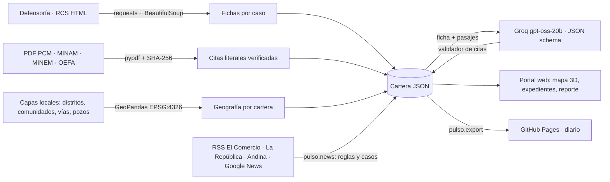
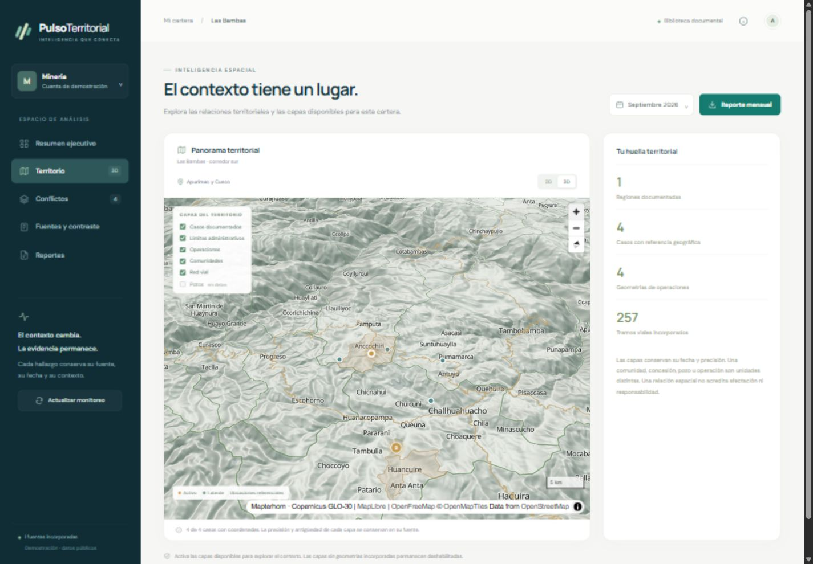
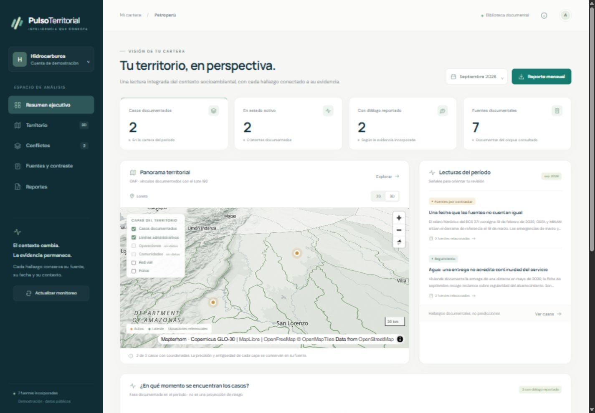
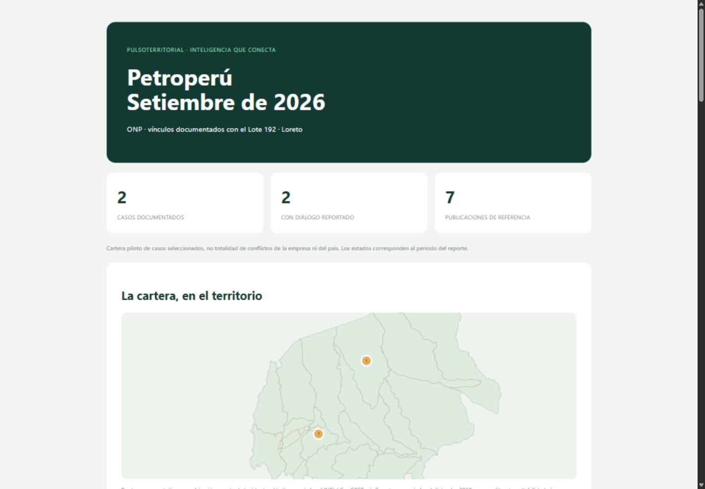

# PulsoTerritorial

**Demo pública:** https://alexnoblejas.github.io/pulso-territorial/ · accesos directos `?company=mineria` y `?company=hidrocarburos`
**Autor:** Alexander Noblejas · Python Intermedio, Diplomatura en Ciencia de Datos (Q-Lab PUCP) · [Issue #204](https://github.com/d2cml-ai/Data-Science-Python/issues/204)

## 1. One-liner

Hacemos monitoreo de conflictos sociales para equipos de relacionamiento comunitario de empresas mineras y de hidrocarburos, mediante un mapa 3D de su territorio y fichas en las que cada afirmación lleva a la página exacta del informe oficial que la sostiene.

## 2. Founder

**Alexander Noblejas.** Trabaja con información de conflictos sociales del Perú: el archivo de reportes mensuales de la Defensoría del Pueblo 2004-2025 y la base histórica que usa este producto vienen de su investigación de tesis. En el curso construyó un MCP sobre GEOPERÚ, un pipeline de OCR y transcripción, y el análisis de incendios en Ucayali.

## 3. Problema

Un equipo de gestión social que sigue una operación tiene que reconstruir cada mes qué dicen la Defensoría, la PCM, el MINAM, el MINEM y el OEFA sobre sus comunidades. Cada entidad publica en un formato distinto (HTML, PDF, notas de prensa), con fechas y nombres que no siempre coinciden. Ejemplo real dentro de la demo: la Defensoría fecha el derrame de Sinchi Roca el 19 de febrero de 2025 y el MINAM el 19 de marzo.

**Evidencia de usuarios:** no se hicieron las tres conversaciones que pide el curso. No se incluyen testimonios inventados; la guía de entrevista está en [`docs/research/`](docs/research/).

## 4. Solución e insight

Dos carteras demo: **Las Bambas** (minería, Apurímac) y **Petroperú** (hidrocarburos, Loreto). Cada cartera reúne:

- **Mapa 3D del territorio:** relieve real, distritos, comunidades, red vial y pozos (GeoPandas), con los casos ubicados.
- **Expedientes por conflicto:** fase oficial, demandas, compromisos y una línea de tiempo con todas las fuentes.
- **Contraste entre instituciones:** cada cita de PCM, MINAM, MINEM u OEFA abre el PDF en la página exacta.
- **Lectura con IA:** Groq extrae hechos, demandas y compromisos; cada afirmación debe traer una cita literal o se descarta.
- **Pulso de medios:** cada día lee los RSS de El Comercio, La República y Andina, y busca en Google News, que agrega RPP, Gestión, Infobae, Expreso y medios regionales. Etiqueta cada nota (medida de fuerza, violencia, seguridad, ambiental, diálogo) y la vincula al caso que menciona. Es la señal diaria entre reportes oficiales mensuales.
- **Reporte mensual:** HTML imprimible con mapa, fases e historia.

**Insight:** el valor no está en resumir, sino en que cada frase sea comprobable. Por eso el producto rechaza lo que no puede verificar:

- **Citas del corpus:** [`pulso/corpus.py`](pulso/corpus.py) comprueba el SHA-256 de cada PDF y que cada cita aparezca literal en la página indicada. Si alguien cambia una cifra o reemplaza el PDF, la cita desaparece; las pruebas cubren ambos casos.
- **Salida de la IA:** [`pulso/service.py`](pulso/service.py) descarta toda afirmación del modelo cuya cita no esté en el texto que recibió. En la prueba real se aceptaron 23 afirmaciones y se descartaron 3.

Límites que la interfaz explicita: una cercanía en el mapa no prueba afectación; la fase es la que reporta la fuente, no una predicción; las carteras son muestras, no el total de conflictos de una empresa.

## 5. Why now

- **IA que se puede verificar:** hoy un modelo abierto en Groq devuelve JSON con un esquema estricto por menos de una décima de centavo de dólar por caso. Hace tres años eso exigía un modelo cerrado, caro y sin salida estructurada confiable.
- **Fuentes en formato estructurado:** la Defensoría publica su reporte mensual también en HTML con fichas por caso (RCS 271), y MINAM/OGASA publica informes mensuales en SINIA.
- **Mapas sin servidor propio:** el relieve abierto de Copernicus y MapLibre permiten mostrar terreno 3D sin licencias.

## 6. Demo y arquitectura

**Pública (GitHub Pages):** https://alexnoblejas.github.io/pulso-territorial/. Un workflow de GitHub Actions ([`pages.yml`](.github/workflows/pages.yml)) la regenera cada día a las 7:00 a. m. (Lima). Primero verifica el corpus, luego revisa nuevas publicaciones de la Defensoría, después lee los RSS de prensa y al final publica.

**Local (con IA en vivo):**

```powershell
.\instalar.ps1
copy .env.example .env   # poner GROQ_API_KEY
.\iniciar.ps1            # http://127.0.0.1:8765  (-Automatizar: ciclo cada 24 h)
```



| Módulo | Qué hace |
|---|---|
| [`pulso/service.py`](pulso/service.py) | Descarga y versiona reportes, controla el gasto diario de IA, llama al proveedor y valida citas |
| [`pulso/corpus.py`](pulso/corpus.py) | Verifica cada PDF del corpus y cada pasaje |
| [`pulso/news.py`](pulso/news.py) | Lee los RSS de prensa, etiqueta las notas y las vincula a casos |
| [`pulso/portfolio.py`](pulso/portfolio.py) | Construye las carteras: casos, fuentes, contraste y lecturas |
| [`pulso/reports.py`](pulso/reports.py) | Genera el reporte mensual en HTML con SVG |
| [`pulso/web.py`](pulso/web.py) | Sirve la API y el portal local |
| [`pulso/export.py`](pulso/export.py) | Genera el sitio estático |
| [`web/`](web/) | Frontend con MapLibre |

**Modelo:** `openai/gpt-oss-20b` en Groq. Se eligió por tres razones: es un modelo abierto, admite salida con esquema JSON estricto y es barato. Se probó en real el 10 de noviembre de 2026 sobre 3 casos y gastó entre 1,390 y 1,920 tokens por caso; el resultado está en [`demo_data/ai_readings.json`](demo_data/ai_readings.json). En la versión pública no hay clave, así que el botón muestra esa lectura guardada con su fecha y modelo. Gemini y NVIDIA están configurados como alternativas, pero no se probaron.

**Corpus incorporado** ([`config/corpus.json`](config/corpus.json), PDF en [`corpus/`](corpus/)):

| Documento | Uso en la demo | Enlace oficial |
|---|---|---|
| Defensoría · RCS 271, setiembre 2026 (HTML) | Fichas de los 6 casos | [defensoria.gob.pe](https://www.defensoria.gob.pe/wp-content/uploads/2026/10/RCS_271_setiembre_2026.html) |
| PCM · Willaqniki N.º 5-2024 | Diálogo con Chuicuni y Fuerabamba (p. 38); Oleoducto (p. 31) | [colección en gob.pe](https://www.gob.pe/institucion/pcm/colecciones/12-reporte-willaqniki) |
| MINAM/OGASA · Informe 03-2025 | Derrame de Sinchi Roca (p. 20) | [SINIA](https://sinia.minam.gob.pe/sites/default/files/archivos/public/docs/03.Informe%20OGASA%20-%20Marzo%202025.pdf), hash idéntico |
| MINAM/OGASA · Informe 09-2025 | Huancuire en prevención (p. 35) | [SINIA](https://sinia.minam.gob.pe/sites/default/files/archivos/public/docs/09.Informe%20OGASA-SETIEMBRE2025%20vf.pdf), hash idéntico |
| MINEM/OGGS · IV trimestre 2016 | Antecedente de Fuerabamba (p. 121) | copia del archivo del autor; URL oficial no confirmada |
| OEFA · Reporte 00015-2022-DEAM-STEC | Puntos de agua sin muestrear por el conflicto (p. 18) | copia del archivo del autor; URL oficial no confirmada |
| OEFA · TFA Res. 497-2022 | Nulidad y retroacción del procedimiento (p. 1) | copia del archivo del autor; URL oficial no confirmada |

Capturas:





## 7. Modelo de negocio y costos

- **Quién paga:** el área de relaciones comunitarias o de asuntos corporativos de una empresa extractiva, o la consultora que le hace el seguimiento.
- **Precio:** piloto de **S/ 299 al mes por cartera**, hasta 25 casos, con reporte mensual. Es una hipótesis: no se validó con clientes.
- **Costo de IA:** según la prueba real, cada lectura usa menos de 2,000 tokens. A la tarifa de terceros de US$ 0.075 por millón de tokens de entrada y US$ 0.30 por millón de salida, eso es menos de **US$ 0.001 por lectura**. Una cartera de 25 casos con lectura diaria cuesta menos de US$ 1 al mes.
- **Costo de servidor:** hoy es US$ 0 (GitHub Pages y Actions). Una versión con cuentas y autenticación necesitaría un servidor pagado.
- **Costo de revisión humana:** no se midió y probablemente es el mayor.

## 8. Herramientas del curso

| Sesión | Uso dentro del producto | Archivo |
|---|---|---|
| **03 Scraping y APIs** | Reportes de la Defensoría (HTML) y RSS de El Comercio, La República, Andina y Google News, con la estrategia de la tarea 1 (RSS y sitemaps permitidos por robots.txt, User-Agent académico, pausas) | `pulso/service.py`, `pulso/news.py` |
| **08 LLMs con salidas estructuradas** | Groq con esquema JSON estricto y validador de citas literales | `pulso/service.py`, `pulso/web.py` |
| **10 Document AI** | pypdf para extraer y verificar pasajes de los PDF; adaptador PaddleOCR opcional | `pulso/corpus.py`, `pulso/ocr_optional.py` |
| 05 Dashboards | Portal con KPIs, fases, evolución y reporte mensual | `web/`, `pulso/reports.py` |
| 06 GeoPandas | Capas normalizadas a EPSG:4326 y mapa 3D con MapLibre | `demo_data/geography_*.json`, `web/app.js` |
| 12 Despliegue | Sitio estático en GitHub Pages, regenerado a diario con Actions | `pulso/export.py`, `.github/workflows/pages.yml` |

**Por qué estas:** las fuentes vienen en HTML y en PDF, lo que pide scraping y Document AI. Para que la IA sirva a un cliente, su salida tiene que ser estructurada y verificable.

## 9. Qué hizo el agente

- **Codex (OpenAI):** construyó la primera versión. Hizo el servidor, el frontend, el modelo de datos de carteras, las capas geográficas y los reportes.
- **Claude Code:** hizo todo lo siguiente.
  - Integró el corpus de PCM, MINAM, MINEM y OEFA con su verificador (`pulso/corpus.py`).
  - Comprobó que los PDF de MINAM son idénticos a los de SINIA.
  - Corrigió la llamada a Groq, que fallaba con `json_validate_failed`, y la probó en real.
  - Detectó que mandar la página entera hacía que el modelo atribuyera frases de casos vecinos, y lo cambió para enviar solo el pasaje.
  - Creó el sitio estático, el workflow diario y las pruebas del corpus.
  - Adaptó el scraper de prensa de la tarea 1 (`pulso/news.py`) y el panel "Pulso de medios".

Las decisiones de qué fuentes usar y cómo presentarlas son del autor. **Verificación:** 32 pruebas `pytest`, incluidas una cita alterada y un PDF reemplazado.

Guion de la presentación: [`docs/PRESENTACION.md`](docs/PRESENTACION.md).

**Pendiente:** entrevistas con usuarios, autenticación real de clientes, envío del reporte por correo, más conectores (PNP, OEFA en línea) y URLs oficiales de tres PDF.
